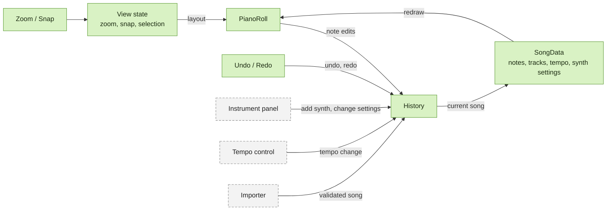
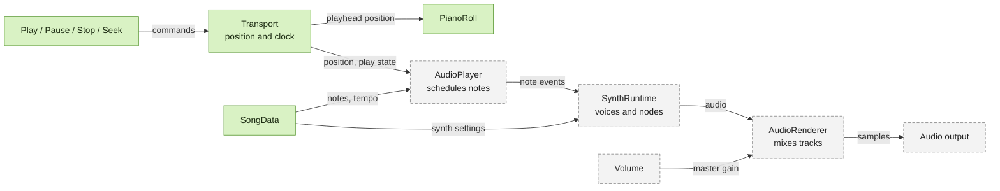
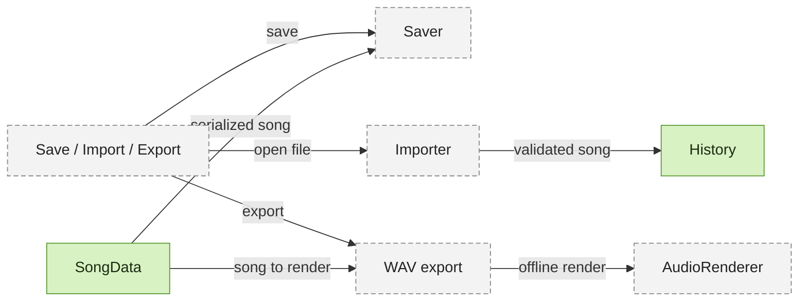

# Architecture

The song data is the single source of truth. User controls change it through
`History`, the piano roll draws it, and the audio side reads it to make sound.
`Transport` owns playback position, so the playhead and the audio stay in sync.

Green boxes exist in the code today, and grey dashed boxes are planned. Arrows
show the direction data or commands flow. `SongData` appears in all three
diagrams, and it is the same object each time.

## Editing

Every change to the song goes through `History`, and the piano roll redraws from
the result.

## Playback

`Transport` owns the position. The playhead and the audio both follow it.

## Files

## Rules

- **All song changes go through `History`.** That includes note edits, tempo,
  synth settings and imports, so undo always works and nothing bypasses it.
- **`SongData` stays plain and JSON-serializable.** It holds synth *settings*.
  Live voices and audio nodes belong to `SynthRuntime`, which is rebuilt from
  those settings.
- **`Transport` is the only owner of playback position.** It will use
  `AudioContext.currentTime` as its clock once audio exists.
- **View state is not song state.** Zoom, snap and selection are not saved with
  the song or tracked by undo.
- **`AudioRenderer` must not depend on real-time playback,** so WAV export can
  reuse it through `OfflineAudioContext`.
- **Imported songs are validated first,** and their note IDs must not collide
  with IDs created afterwards.

## Where it lives in the code

| Diagram box | Code |
| --- | --- |
| `PianoRoll` | `app/src/lib/pianoroll/PianoRoll.svelte` |
| `History` | `app/src/lib/song/history.ts` |
| `SongData` | `app/src/lib/song/song.ts`, changed through `edits.ts` |
| `Transport` | `app/src/lib/song/transport.ts` |
| Toolbar controls, wiring | `app/src/App.svelte` |

Selection currently lives inside `PianoRoll.svelte`, and zoom and snap in
`App.svelte`. There is no separate view-state module yet.
